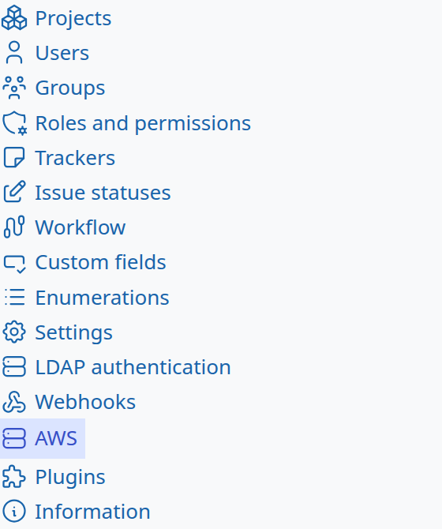
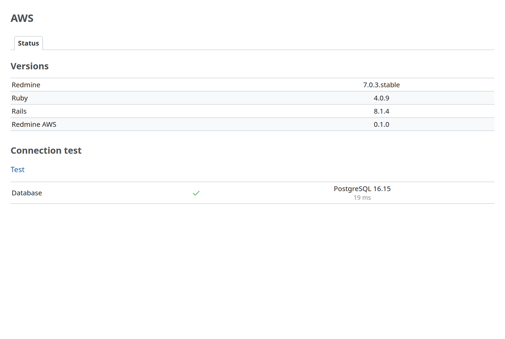

# Administration pages

This page describes the "AWS" item of Redmine's administration menu, which every Redmine Kit AWS plugin shares, and the "Status" tab that Redmine Kit AWS puts there. The page lets you check the state of the connections to the database and to AWS from within Redmine. [Redmine Kit AWS S3](https://redmine-kit.github.io/redmine_aws_s3/admin.html), [Redmine Kit AWS SES](https://redmine-kit.github.io/redmine_aws_ses/admin.html), [Redmine Kit AWS SQS](https://redmine-kit.github.io/redmine_aws_sqs/admin.html) and [Redmine Kit AWS Cost Explorer](https://redmine-kit.github.io/redmine_aws_costexplorer/) add their pages as tabs here when they are installed, and [Redmine Kit AWS Lambda](https://redmine-kit.github.io/redmine_aws_lambda/admin.html) adds its values to the Status tab.

The specifications in this page were checked against official information and the Redmine 7.0.3 source as of 2026-11-08. Sources are in [sources.md](https://redmine-kit.github.io/serverless/sources.html).

## Approach

| Item | Details |
| --- | --- |
| Administrators only | Every page can be opened only by Redmine administrators. It uses the same check as Redmine's administration pages (`require_admin`) |
| No secrets shown | Values in SSM Parameter Store, `SECRET_KEY_BASE` and the database password are not shown. Only the names of the variables set from Parameter Store are shown |
| Call AWS APIs only when needed | Opening a tab calls no AWS API: the tabs show values that are stored. The one exception is the message counts on the "Jobs" tab of [Redmine Kit AWS SQS](https://redmine-kit.github.io/redmine_aws_sqs/), which are cached for 60 seconds. The connection test runs only when its button is pressed (one light call per service, in the request) |
| Non-secret settings are changed on the page | Non-secret settings are plugin settings (Redmine's `Setting.plugin_*`, stored in the database) and can be changed on the page. Values set by the infrastructure, such as AWS resource names, stay as environment variables and are only displayed |
| Operations are logged | Operations on the pages are written to Redmine's log with who did what and when |

## List of pages

| Page | Added by | Contents |
| --- | --- | --- |
| Status | This plugin | The versions, the names of the settings read, the values the other plugins add (such as the Lambda function), and whether the database and each AWS service are reachable |
| Jobs | [Redmine Kit AWS SQS](https://redmine-kit.github.io/redmine_aws_sqs/admin.html) | Added by that plugin when it is installed |
| Email sending, Email receiving | [Redmine Kit AWS SES](https://redmine-kit.github.io/redmine_aws_ses/admin.html) | Added by that plugin when it is installed |
| S3 | [Redmine Kit AWS S3](https://redmine-kit.github.io/redmine_aws_s3/admin.html) | Added by that plugin when it is installed |
| Cost Explorer | [Redmine Kit AWS Cost Explorer](https://redmine-kit.github.io/redmine_aws_costexplorer/) | Added by that plugin when it is installed |

## The AWS menu

All the Redmine Kit AWS plugins put their administration pages under one item, "AWS", in Redmine's administration menu. The pages are tabs of one page.

| Item | Details |
| --- | --- |
| One item | This plugin holds the menu: the registry `RedmineKit::Aws::Admin`, the controller `AwsAdminController` and the view `aws_admin/_tabs`. Each plugin registers its tab and its connection check there from `init.rb` (`register_tab`, `register_check`; [api.md](api.md)); the first registration adds the menu item. The item opens `/admin/aws`, which goes to the first tab |
| Order of the tabs | Status, Jobs, Email sending, Email receiving, S3, Cost Explorer. A tab appears only when its plugin is installed |
| From the plugin list | The plugins have no settings page of Redmine's plugin settings, so the plugin list shows no "Configure" link. Their settings are on their tabs |
| Project settings | The "Email" tab in project settings that Redmine Kit AWS SES adds is not part of this menu |

## Status

| Item | Contents | Source |
| --- | --- | --- |
| Versions | Redmine, Ruby, Rails, the installed Redmine Kit AWS plugins | The same as Redmine's information page |
| Parameter Store | The names of the variables set from Parameter Store (values are not shown); a variable that was already set keeps its value and is not listed. Shown when [Redmine Kit AWS SSM](https://redmine-kit.github.io/redmine_aws_ssm/) is installed | The result of reading them at start-up (`RedmineKit::Aws::Ssm.loaded`) |
| Values of the other plugins | Sections that the other plugins add (`register_status_section`; [api.md](api.md#the-status-tab)). Redmine Kit AWS Lambda adds the Lambda function before the versions and the read-only settings after them ([its admin.md](https://redmine-kit.github.io/redmine_aws_lambda/admin.html)) | The plugin that adds them |
| Connection test | Whether the database and the AWS services of the installed plugins are reachable, and the response time in milliseconds | When "Test" is clicked, one light call to each (table below) |

| Target | API called |
| --- | --- |
| Database | Open a new connection to the configured database (such as RDS for PostgreSQL) and read the server's version (`SHOW server_version`), shown with the adapter, such as "PostgreSQL 16.4" |
| S3 | `HeadBucket`, added by Redmine Kit AWS S3 |
| SES | `GetAccount`, added by Redmine Kit AWS SES |
| SQS | `GetQueueAttributes`, added by Redmine Kit AWS SQS |

Each check uses the permission that its plugin lists on its IAM page; this plugin needs none of its own.

When a check fails, the details show only the class of the error, such as `Aws::S3::Errors::Forbidden` or `Seahorse::Client::NetworkingError`. The error's message, which may name hosts, accounts or resources, is not shown on the page; it is written to Redmine's log with the name of the check (`[redmine_kit_aws] connection check s3 failed: …`).

Use the checks after changing IAM permissions, network settings or SSM settings, to see how far requests reach. In a VPC, they also help check the VPC endpoint and security group settings.

### In the new UI

With [Redmine Kit UI](https://github.com/redmine-kit/redmine_kit_ui) installed, the new UI draws the Status tab itself (`config/kit_ui.yml`, the component `AwsStatus` built from `frontend/` into `assets/javascripts/kit/aws.js`). It shows the same values and allows the same, from the same controller and with the same check (`require_admin`):

| Part | In the new UI |
| --- | --- |
| The AWS menu | Administration's sidebar has the item "AWS" with the icon `server`; it opens the first tab. The page has the header "AWS" and one strip of tabs, to which the other Redmine Kit AWS plugins add theirs ([api.md](api.md#the-new-ui)) |
| The sections of values | One section per section of Redmine's page, in the same order and with the same headings: label and value pairs, a list of names (Parameter Store), or "No data to display" |
| Connection test | "Test" in the section's heading runs the checks (`POST /admin/aws/status/check.json`); each check is a row with its name, what it returned or the class of its error under it, the time it took and its state (an icon named "OK" or "Failed") |
| While loading | The Versions section's first rows and the connection test; the other rows and sections come with the data |

The tab reads `GET /admin/aws/status.json` (the sections of values: each section's name, heading and rows) with the browser's session. The values are formatted on the server with Redmine's helpers, the same as on Redmine's page.

## Permissions

The pages call no AWS API of this plugin's own; see [iam.md](iam.md).

## Tests

Each page has Redmine functional tests ([testing.md](https://redmine-kit.github.io/serverless/testing.html#administration-pages)).

The screenshots on this page are taken with `bin/screenshots` (headless Chromium in Apple container when it runs, else in Docker, with Redmine's test data). Run it after changing a screen.
