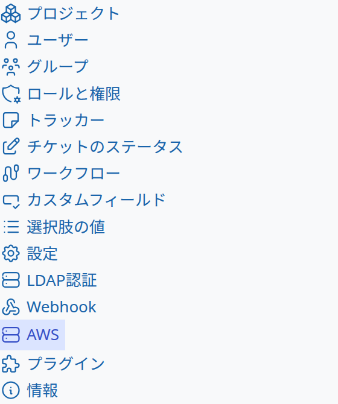
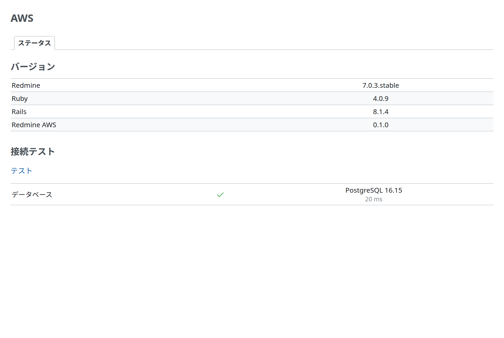

# 管理画面

すべての Redmine Kit AWS のプラグインが共有する、Redmine の管理メニューの「AWS」の項目と、そこに Redmine Kit AWS が置く「ステータス」のタブです。データベースと AWS への接続の状態を、Redmine の画面で確認できます。[Redmine Kit AWS S3](https://redmine-kit.github.io/redmine_aws_s3/ja/admin.html)、[Redmine Kit AWS SES](https://redmine-kit.github.io/redmine_aws_ses/ja/admin.html)、[Redmine Kit AWS SQS](https://redmine-kit.github.io/redmine_aws_sqs/ja/admin.html)、[Redmine Kit AWS Cost Explorer](https://redmine-kit.github.io/redmine_aws_costexplorer/ja/) をインストールすると、それぞれの画面がここのタブに追加されます。[Redmine Kit AWS Lambda](https://redmine-kit.github.io/redmine_aws_lambda/ja/admin.html) は、ステータスのタブに値を追加します。

この資料の仕様は、2026-11-08 時点の公式の情報と、Redmine 7.0.3 のソースで確認したものです。出典は [sources.md](https://redmine-kit.github.io/serverless/ja/sources.html) にあります。

## 方針

| 項目 | 内容 |
| --- | --- |
| システム管理者だけ | どの画面も、システム管理者だけが開けます。Redmine の管理画面と同じ確認 (`require_admin`) を使います |
| シークレットを表示しない | SSM Parameter Store の値、`SECRET_KEY_BASE`、データベースのパスワードは表示しません。Parameter Store から設定した変数の名前だけを表示します |
| AWS の API は必要なときだけ呼ぶ | タブを開いても AWS の API は呼びません。タブは保存してある値を表示します。例外は [Redmine Kit AWS SQS](https://redmine-kit.github.io/redmine_aws_sqs/ja/) の「ジョブ」のタブのメッセージの件数で、60 秒間キャッシュします。接続テストはボタンを押したときだけ実行します (サービスごとに軽い呼び出しを 1 回、そのリクエストの中で) |
| シークレットでない設定は画面で変更する | シークレットでない設定は、プラグインの設定 (Redmine の `Setting.plugin_*`。データベースに保存) にし、画面で変更できます。AWS のリソース名など、インフラで決まる値は、環境変数のまま表示だけします |
| 操作はログに記録する | 画面での操作は、誰がいつ何をしたかを Redmine のログに記録します |

## 画面一覧

| 画面 | 追加するプラグイン | 内容 |
| --- | --- | --- |
| ステータス | このプラグイン | バージョン、読み込んだ設定の名前、ほかのプラグインが追加する値 (Lambda 関数など)、データベースと AWS の各サービスに接続できるか |
| ジョブ | [Redmine Kit AWS SQS](https://redmine-kit.github.io/redmine_aws_sqs/ja/admin.html) | そのプラグインをインストールしたときに追加される |
| メール送信、メール受信 | [Redmine Kit AWS SES](https://redmine-kit.github.io/redmine_aws_ses/ja/admin.html) | そのプラグインをインストールしたときに追加される |
| S3 | [Redmine Kit AWS S3](https://redmine-kit.github.io/redmine_aws_s3/ja/admin.html) | そのプラグインをインストールしたときに追加される |
| Cost Explorer | [Redmine Kit AWS Cost Explorer](https://redmine-kit.github.io/redmine_aws_costexplorer/ja/) | そのプラグインをインストールしたときに追加される |

## AWS メニュー

Redmine Kit AWS のプラグインは、管理画面を Redmine の管理メニューの 1 つの項目「AWS」の下に置きます。画面は、1 つのページのタブになります。

| 項目 | 内容 |
| --- | --- |
| 項目は 1 つ | メニューはこのプラグインが持ちます。登録先の `RedmineKit::Aws::Admin`、コントローラーの `AwsAdminController`、ビューの `aws_admin/_tabs` です。各プラグインは、`init.rb` から自分のタブと接続テストを登録します (`register_tab`、`register_check`。[api.md](api.md))。最初の登録がメニューの項目を追加します。項目は `/admin/aws` を開き、そこから最初のタブに移動します |
| タブの順序 | ステータス、ジョブ、メール送信、メール受信、S3、Cost Explorer。タブは、そのプラグインをインストールしているときだけ表示されます |
| プラグイン一覧から | プラグインは Redmine のプラグインの設定画面を持たないので、プラグイン一覧に「設定」のリンクは表示されません。設定は、それぞれのタブにあります |
| プロジェクトの設定 | Redmine Kit AWS SES がプロジェクトの設定に追加する「メール」のタブは、このメニューに含みません |

## ステータス

| 項目 | 内容 | 取得元 |
| --- | --- | --- |
| バージョン | Redmine、Ruby、Rails、インストールした Redmine Kit AWS のプラグイン | Redmine の「情報」の画面と同じもの |
| Parameter Store | Parameter Store から設定した変数の名前 (値は表示しない)。すでに設定されていた変数は、値を変えず、一覧にも含めない。[Redmine Kit AWS SSM](https://redmine-kit.github.io/redmine_aws_ssm/ja/) をインストールしたときに表示する | 起動時に読み込んだ結果 (`RedmineKit::Aws::Ssm.loaded`) |
| ほかのプラグインの値 | ほかのプラグインが追加する項目 (`register_status_section`。[api.md](api.md#the-status-tab))。Redmine Kit AWS Lambda は、バージョンの前に Lambda 関数を、後に読み取り専用の設定を追加する ([そのプラグインの admin.md](https://redmine-kit.github.io/redmine_aws_lambda/ja/admin.html)) | 追加するプラグイン |
| 接続テスト | データベースと、インストールしたプラグインの AWS のサービスに接続できるか、応答時間 (ミリ秒) | 「テスト」を押したときに、軽い呼び出しを 1 回ずつ実行する (下の表) |

| 確認先 | 呼び出す API |
| --- | --- |
| データベース | 設定したデータベース (RDS for PostgreSQL など) への新しい接続を作成し、サーバーのバージョン (`SHOW server_version`) を読み込む。「PostgreSQL 16.4」のように、アダプターといっしょに表示する |
| S3 | `HeadBucket`。Redmine Kit AWS S3 が追加する |
| SES | `GetAccount`。Redmine Kit AWS SES が追加する |
| SQS | `GetQueueAttributes`。Redmine Kit AWS SQS が追加する |

それぞれの確認は、そのプラグインが IAM 権限のページに記載した権限を使います。このプラグイン自身の権限は不要です。

確認が失敗したときは、詳細に例外のクラスだけを表示します (`Aws::S3::Errors::Forbidden`、`Seahorse::Client::NetworkingError` など)。ホスト、アカウント、リソースを含むことがある例外のメッセージは画面に表示せず、確認の名前といっしょに Redmine のログに記録します (`[redmine_kit_aws] connection check s3 failed: …`)。

IAM 権限、ネットワークの設定、SSM の設定を変更したあとは、接続テストで、リクエストがどこまで届くかを確認できます。VPC では、VPC エンドポイントやセキュリティグループの設定の確認にも使えます。

### 新しい UI

[Redmine Kit UI](https://github.com/redmine-kit/redmine_kit_ui) をインストールしていれば、「ステータス」のタブは新しい UI が描画します (`config/kit_ui.yml`。`frontend/` から `assets/javascripts/kit/aws.js` にビルドするコンポーネント `AwsStatus`)。同じコントローラーと同じチェック (`require_admin`) で、同じ値を表示し、同じ操作ができます。

| 部分 | 新しい UI |
| --- | --- |
| AWS メニュー | 「管理」のサイドバーに、アイコン `server` の項目「AWS」があり、最初のタブを開きます。ページには見出し「AWS」と 1 列のタブがあり、ほかの Redmine Kit AWS のプラグインがそこにタブを追加します ([api.md](api.md#the-new-ui)) |
| 値の項目 | Redmine の画面の項目ごとに 1 つの項目を、同じ順序と見出しで表示します。ラベルと値の組、名前の一覧 (Parameter Store)、または「表示するデータがありません」 |
| 接続テスト | 項目の見出しの「テスト」で確認を実行します (`POST /admin/aws/status/check.json`)。確認ごとに 1 行で、名前、その下に返した値または例外のクラス、かかった時間、状態 (名前が「OK」または「失敗」のアイコン) を表示します |
| 読み込み中 | 「バージョン」の項目の最初の行と、接続テスト。ほかの行と項目は、データといっしょに表示します |

タブは、ブラウザーのセッションで `GET /admin/aws/status.json` (値の項目。項目ごとの名前、見出し、行) を読み込みます。値は、Redmine の画面と同じく、サーバーで Redmine のヘルパーを使って整形します。プラグインがビューのパーシャルとして登録した項目は、Redmine の画面にだけ表示します。

## 権限

画面は、このプラグイン自身の AWS の API を呼びません。[iam.md](iam.md) を参照してください。

## テスト

画面ごとに、Redmine の機能テストがあります ([testing.md](https://redmine-kit.github.io/serverless/ja/testing.html#administration-pages))。

このページのスクリーンショットは、`bin/screenshots` で撮影します (Apple container が動いていれば Apple container、そうでなければ Docker のヘッドレス Chromium と、Redmine のテストデータ)。画面を変更したら実行します。
